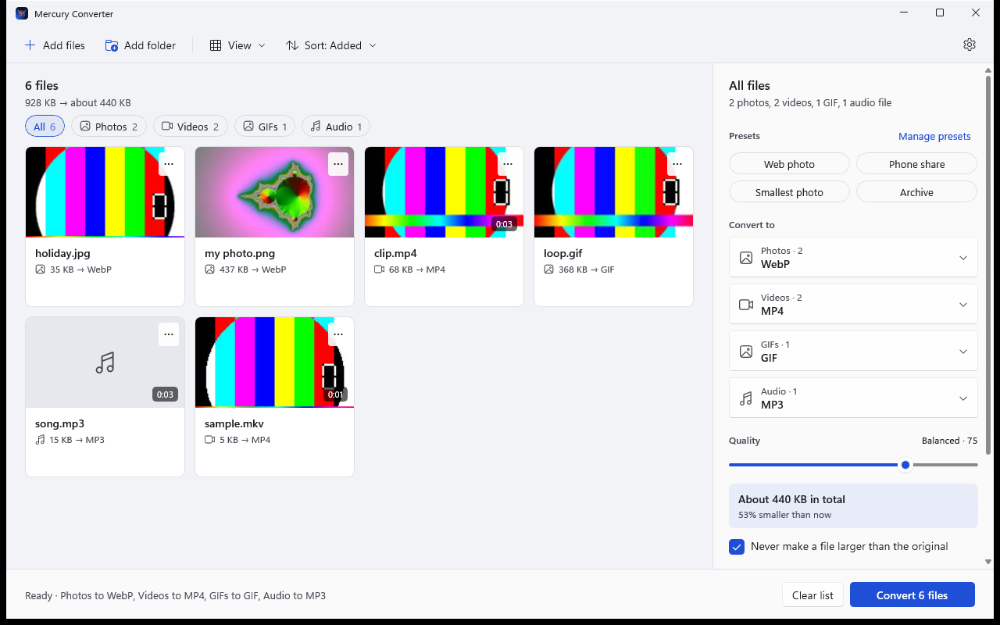
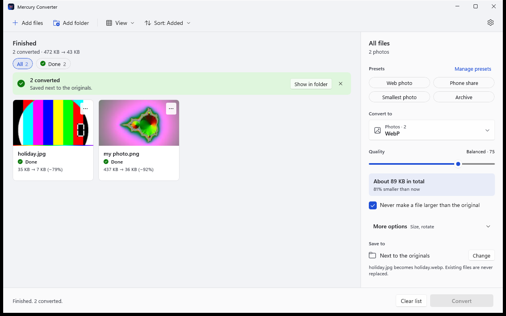
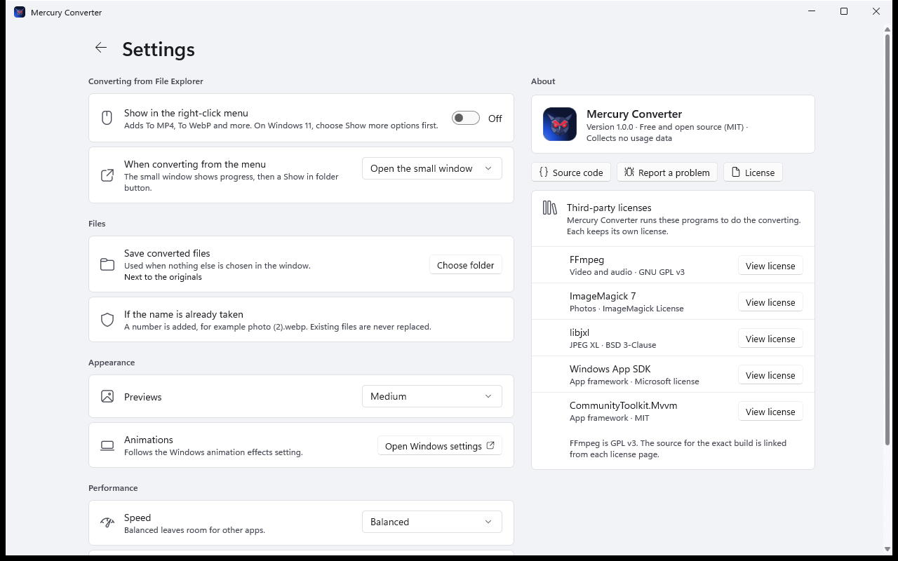
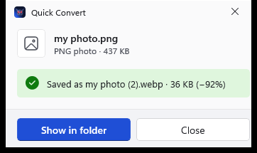
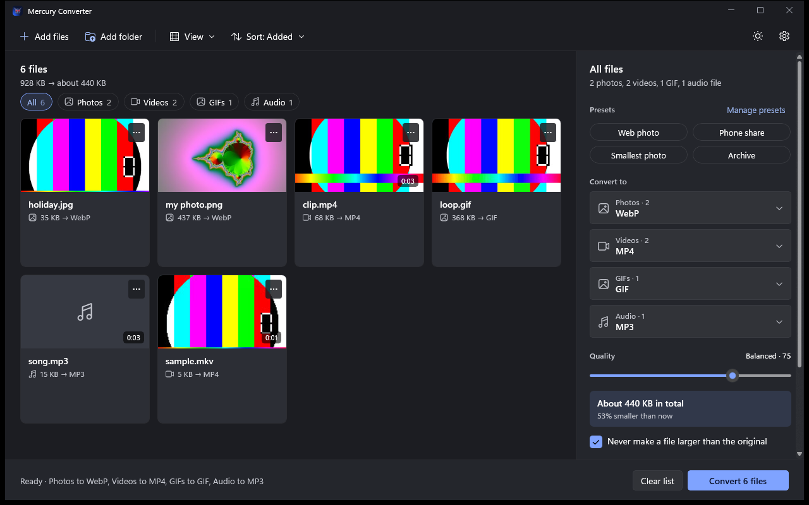

<div align="center">


# Mercury Converter

**Convert photos, GIFs, video and audio on your own computer.**<br>
Free, open source, and nothing is ever uploaded.

[](https://github.com/AfridexD/MercuryConverter/releases/latest/download/MercuryConverter-x64-setup.exe)
&nbsp;
[](https://afridexd.github.io/MercuryConverter/)

[](https://github.com/AfridexD/MercuryConverter/releases/latest)
[](https://github.com/AfridexD/MercuryConverter/releases)
[](LICENSE)


<br>



</div>

<br>

## See it in action

<div align="center">

[](https://youtu.be/6eQDlNcv1mk)

**[Watch the video](https://youtu.be/6eQDlNcv1mk)**: *I Built My Own Free File Converter: Free, Open Source, Local*

</div>

## What people are saying

- **[Mercury Converter Review: Free File Converter](https://sudoreview.dev/reviews/mercury-converter-review/)** on Sudo Review.

## Why Mercury

Most converters make you pick a codec, a bitrate and a container before you can do anything. Mercury asks one question: *what do you want it to become?* Drop your files in, pick a format, and press **Convert**.

- **Simple.** One quality slider from *Smallest file* to *Best quality*, with the expected size shown before you start.
- **Private.** Everything runs on your PC. No account, no upload, no tracking.
- **Safe.** Your originals are never changed and existing files are never overwritten.
- **Kind to your PC.** It watches how busy the computer is and adjusts, and can decode video on your graphics card.
- **From File Explorer.** Right-click a file, choose *To WebP* or *To MP4*, and a small window does the rest.

## Download

| | |
|---|---|
| **[Installer (recommended)](https://github.com/AfridexD/MercuryConverter/releases/latest/download/MercuryConverter-x64-setup.exe)** | Installs for just you, or for everyone on the PC. No administrator password needed for "just me". |
| [Portable zip](https://github.com/AfridexD/MercuryConverter/releases/latest/download/MercuryConverter-x64-portable.zip) | Unzip anywhere and run `MercuryConverter.exe`. |
| [All releases and checksums](https://github.com/AfridexD/MercuryConverter/releases) | Every version, with SHA-256 checksums. |

Needs Windows 10 (version 2004 or later) or Windows 11, 64-bit.

> **Windows may warn you the first time.** Mercury is new and not code-signed yet, so SmartScreen can say "Windows protected your PC". Choose **More info**, then **Run anyway**. You can compare the file with the checksum on the release page first.

## What it converts

| Kind | Open | Convert to |
|---|---|---|
| **Photos** | JPEG, PNG, HEIC, WebP, AVIF, JPEG XL, TIFF, BMP, camera RAW (DNG, CR2, NEF, ARW, RAF) and more | WebP, JPEG, JPEG XL, AVIF, PNG, TIFF, PDF |
| **GIFs** | GIF | GIF, MP4, WebM |
| **Video** | MP4, MOV, MKV, WebM, AVI, WMV, FLV, MPEG, 3GP, TS and more | MP4, WebM, MKV, OGV, AVI, GIF |
| **Audio** | MP3, M4A, AAC, FLAC, WAV, OGG, Opus, WMA, AIFF and more | MP3, AAC, OGG, FLAC, WAV |

## Highlights

<table>
<tr>
<td width="50%" valign="top">

### Everything at a glance
Previews, sizes, a progress bar for every file, and filters for *Converting*, *Waiting*, *Done* and *Failed*.



</td>
<td width="50%" valign="top">

### Options that fit your files
The panel on the right only shows what applies: photos get a quality slider, audio gets channels, and so on. Save your favorite settings as **presets**.



</td>
</tr>
<tr>
<td width="50%" valign="top">

### Right-click, done
Pick *Mercury Converter → To MP4* in File Explorer. A small window shows progress, then a **Show in folder** button.



</td>
<td width="50%" valign="top">

### Smarter than a slider
- Files never get bigger by surprise: quality is lowered and retried, and if it still cannot shrink, nothing is saved and your original is left alone.
- JPEG to **JPEG XL without any loss**, and back to the exact original.
- Resize, rotate and flip.
- **Light and dark themes**, following Windows or your choice, with a sun/moon button in the top bar.
- **Remove location and camera details** from photos, videos and songs before you share them.
- **Pull the sound out of a video** as MP3, AAC or FLAC.
- A notification when a long batch finishes, and an optional heads-up when a new version is out (off until you say yes).
- Taskbar progress, drag and drop, and full keyboard control.

</td>
</tr>
</table>

<div align="center">

**Light or dark.** Mercury follows your Windows setting, or you can choose.



</div>

## Documentation

The [documentation site](https://afridexd.github.io/MercuryConverter/) has a step-by-step guide, the right-click menu, presets, keyboard shortcuts, and answers to common questions:

- [Getting started](https://afridexd.github.io/MercuryConverter/guide.html)
- [Right-click menu](https://afridexd.github.io/MercuryConverter/guide.html#right-click)
- [Questions and fixes](https://afridexd.github.io/MercuryConverter/faq.html)
- [Building from source](docs/BUILDING.md)

## Build from source

You need the [.NET 10 SDK](https://dotnet.microsoft.com/download). The full guide is in [docs/BUILDING.md](docs/BUILDING.md).

```powershell
# Fetch FFmpeg, libjxl and ImageMagick into .\tools (needs 7-Zip and ImageMagick: winget install 7zip.7zip ImageMagick.ImageMagick)
powershell -ExecutionPolicy Bypass -File scripts\fetch-tools.ps1

dotnet build MercuryConverter.slnx
dotnet test MercuryConverter.slnx
```

## Project layout

| Folder | What is in it |
|---|---|
| `src/Mercury.Converter.Core` | The conversion engine: commands, quality mapping, safe output, resource governor, thumbnails, presets |
| `src/Mercury.Converter.App` | The WinUI 3 app |
| `tests/` | Unit tests and real-conversion tests |
| `scripts/` | Fetching the converter programs, building the installer and release files |
| `installer/` | Inno Setup script |
| `branding/` | Icon and logo files |
| `docs/` | The documentation site, design files and the UI study |

## Credits and licenses

Mercury Converter is [MIT licensed](LICENSE). How it keeps you safe is described in [SECURITY.md](SECURITY.md). It runs these excellent programs, each as a separate process under its own license: [FFmpeg](https://ffmpeg.org/) (GPL v3), [ImageMagick](https://imagemagick.org/) and [libjxl](https://github.com/libjxl/libjxl). See [THIRD-PARTY-NOTICES.md](THIRD-PARTY-NOTICES.md).

## Code signing

The downloads are not code-signed yet, so Windows SmartScreen may warn you the first time. Signing is being set up: see the [code signing policy](https://afridexd.github.io/MercuryConverter/code-signing.html) and [docs/SIGNING.md](docs/SIGNING.md). Until then, compare the SHA-256 checksum on the release page.

## Known limits

- On Windows 11 the right-click menu is under **Show more options** (or hold Shift while you right-click).
- English only for now. Translations are planned.
- Not code-signed yet.

Found a problem or have an idea? [Open an issue](https://github.com/AfridexD/MercuryConverter/issues/new).
